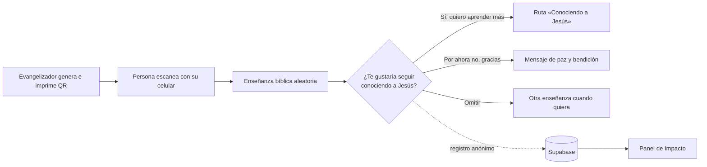
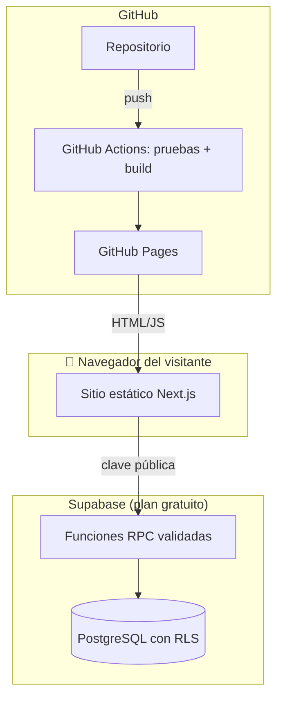

# Un Encuentro con Jesús

> **«Un código, una enseñanza, una oportunidad para conocer a Jesús»**

Plataforma de evangelización digital con códigos QR: quien escanea un código recibe en su celular una enseñanza bíblica breve, elegida al azar, y puede decir de forma voluntaria y anónima si quiere seguir conociendo a Jesús.

🌐 **Sitio en vivo:** https://jquinterocard.github.io/evangelismo/
💻 **Código:** https://github.com/jquinterocard/evangelismo

---

## 1. El problema

- Compartir el evangelio en la calle, en el trabajo o con desconocidos no siempre es fácil: falta tiempo, confianza o el material adecuado.
- Los volantes impresos se leen poco y no dicen nada de su alcance.
- Muchas herramientas digitales cuestan dinero, piden registro o recogen datos personales.

## 2. La solución

Un **código QR impreso** (en tarjetas, volantes o carteles) que abre, desde cualquier celular y sin instalar nada, una enseñanza centrada en Jesucristo con:

1. **Versículo bíblico** (NVI) y su contexto.
2. **Explicación** sencilla.
3. **Reflexión** espiritual.
4. **Aplicación práctica** para el día.
5. **Oración sugerida**.

El mismo QR muestra **una enseñanza distinta en cada visita**. Así se puede volver a escanear y siempre hay algo nuevo.

---

## 3. Cómo funciona

### El recorrido del visitante
1. **Escanea** el QR, que lleva a `…/?qr=<identificador-aleatorio>`.
2. **Lee** la enseñanza. No hay registro, no se piden datos y no hay publicidad.
3. **Responde, si quiere**, con tres botones del mismo tamaño y sin presión: *Sí / Por ahora no / Omitir*.
4. **Continúa:** si dijo «Sí», se le ofrece la ruta **«Conociendo a Jesús»** (10 temas) y temas recomendados.
5. **Comparte** la enseñanza por **WhatsApp** con un toque.

### El recorrido del evangelizador
1. **Genera QR** con 5 plantillas (cruz, corazón, paloma, Biblia y minimalista) y colores personalizables.
2. **Descarga** un PNG, una **tarjeta lista para imprimir** o un **lote ZIP de hasta 100 códigos**.
3. **Ve el impacto:** enseñanzas completadas, respuestas positivas, negativas y omitidas, tasa de interés y enseñanzas más leídas.

---

## 4. Funcionalidades

| Área | Qué incluye |
|---|---|
| 📖 **Contenido** | 60 enseñanzas originales en 20 temas (amor de Dios, salvación, perdón, fe, esperanza, oración, paz, gracia, parábolas, milagros…) |
| ✝️ **Ruta «Conociendo a Jesús»** | 10 temas: ¿Quién es Jesús?, salvación, perdón, oración, muerte y resurrección…, con progreso opcional |
| 🔳 **Generador QR** | Plantillas con emblema central, corrección de errores alta, tarjetas imprimibles y lotes ZIP |
| 🎲 **Selección aleatoria** | En el propio celular, sin repetir las enseñanzas recientes |
| ❤️ **Interés voluntario** | Una sola respuesta por lectura, anónima, garantizada por la base de datos |
| 📊 **Impacto** | Tarjetas, gráficas por día, semana y mes, tasa de interés positivo y proyecciones |
| 💬 **WhatsApp** | Botón flotante para compartir el sitio y botón por enseñanza |
| 🌙 **Modo noche** | Se activa o desactiva y se recuerda en el dispositivo |
| 📱 **Experiencia móvil** | Barra de navegación inferior estilo app; se puede instalar como app (PWA) |
| ♿ **Accesibilidad** | Navegación con teclado, lector de pantalla, contraste revisado y respeto a «reducir movimiento» |

---

## 5. Métricas de impacto (y cómo leerlas)

| Indicador | Qué significa |
|---|---|
| **Enseñanzas completadas** | Veces que alguien respondió la pregunta final tras leer |
| **Respuestas positivas** | «Sí, quiero aprender más» |
| **Respuestas negativas** | «Por ahora no, gracias» |
| **Preguntas omitidas** | Se eligió «Omitir» |
| **Tasa de interés positivo** | positivas ÷ (positivas + negativas) × 100 |
| **Proyección** | Estimación según el promedio diario registrado |

> **Principio ético:** los números acompañan el servicio, no lo miden. Una lectura **no es** una persona única ni una conversión, y los indicadores **no** representan el valor espiritual de nadie. No es una competencia.

---

## 6. Privacidad y seguridad

- **Sin datos personales:** no se piden nombre, correo ni teléfono, no se guardan direcciones IP y no se crean perfiles.
- **Identificador de sesión aleatorio:** vive en la pestaña del navegador y se borra al cerrarla.
- **Base de datos protegida:**
  - Row Level Security activado; el navegador **no puede leer ni modificar tablas**.
  - Solo puede llamar a 4 funciones validadas, con:
    - **anti-duplicados**, porque cada lectura acepta una sola respuesta;
    - **límites de uso** por sesión, por QR y globales;
    - **sin contadores editables:** las cifras se calculan a partir de los eventos.
- **Claves:** en el sitio solo va la clave pública (*publishable*). La clave secreta nunca sale del panel de Supabase.
- **Navegador:** política de seguridad de contenido (CSP) y validación de todas las entradas.

---

## 7. Tecnología

| Capa | Herramienta |
|---|---|
| Interfaz | **Next.js 16** (App Router) · **React 19** · **TypeScript** |
| Estilos | **Tailwind CSS 4** · ilustraciones SVG originales · fuentes Lora y Nunito Sans |
| QR y gráficas | `qrcode` · `jszip` · **Recharts** |
| Datos compartidos | **Supabase** (PostgreSQL + funciones RPC) |
| Hosting | **GitHub Pages** (sitio estático) con despliegue automático por **GitHub Actions** |
| Calidad | **Vitest** + Testing Library: **93 pruebas automáticas** (incluida la base de datos real sobre PostgreSQL embebido) |

### Costo de operación: **$0**
- GitHub Pages es gratuito.
- Supabase tiene un plan gratuito de 500 MB, suficiente para millones de registros.
- No hace falta dominio propio para empezar.

---

## 8. Guion sugerido para la demo (5–7 min)

| Tiempo | Paso | Qué mostrar |
|---|---|---|
| 0:00 | **Contexto** | El problema y el lema del proyecto |
| 0:45 | **Inicio** | Portada, ilustraciones y los 20 temas |
| 1:30 | **Generar QR** | Elegir plantilla, descargar la **tarjeta para imprimir** |
| 2:30 | **Escaneo en vivo** | Que alguien del público escanee el QR proyectado → ve una enseñanza |
| 3:30 | **Pregunta final** | Mostrar las tres opciones y responder «Sí» → ruta «Conociendo a Jesús» |
| 4:15 | **Impacto** | Pulsar «Actualizar»: se ve la nueva lectura y la respuesta en tiempo real |
| 5:00 | **Extras** | Compartir por WhatsApp, modo noche, barra móvil |
| 5:45 | **Cierre** | Privacidad, costo $0 y próximos pasos |

**Antes de la demo:**
- Abre `/impacto` y lee una enseñanza para «despertar» Supabase, porque el plan gratuito se pausa tras unos 7 días sin uso.
- Ten un QR ya impreso como respaldo por si falla la proyección.
- Comprueba que el celular de prueba tenga datos o Wi-Fi.

---

## 9. Retos y aprendizajes

- **Sitio estático + base de datos segura:** sin servidor propio, toda la validación y la protección contra abuso viven dentro de PostgreSQL (RLS y funciones `SECURITY DEFINER`).
- **Aleatoriedad sin repetición:** el sorteo se hace en el celular y recuerda las últimas enseñanzas de la sesión.
- **QR con emblema legible:** el símbolo central ocupa como máximo el 20 % del código y se usa corrección de errores alta. Se verificó decodificando las imágenes en las pruebas.
- **Ética de las métricas:** se diseñaron para acompañar, no para competir, y se dejó claro qué significa y qué no significa cada número.

---

## 10. Próximos pasos

- [ ] Revisar las 77 citas NVI contra una Biblia impresa (`docs/REVISION-CITAS.md`).
- [ ] Dominio propio (por ejemplo `unencuentroconjesus.org`).
- [ ] Protección anti-abuso más fuerte (CAPTCHA invisible + función en el servidor).
- [ ] Panel administrativo para editar enseñanzas sin tocar código.
- [ ] Cuentas para evangelizadores, **equipos e iglesias** con metas propias.
- [ ] Estadísticas por QR, para saber qué tarjetas o lugares funcionan mejor.
- [ ] Seguimiento voluntario de interesados, **solo con consentimiento explícito**.
- [ ] Contenido en otros idiomas.

---

## 11. Preguntas frecuentes (para el turno de preguntas)

**¿Hay que instalar algo para leer una enseñanza?**
No. Basta con la cámara del celular. Opcionalmente se puede instalar como app.

**¿Se guardan datos de quien escanea?**
No se guardan datos personales. Solo la enseñanza leída, el QR, la fecha y la respuesta voluntaria, de forma anónima.

**¿Cuánto cuesta mantenerlo?**
Nada en su escala actual: GitHub Pages y el plan gratuito de Supabase.

**¿Qué pasa si Supabase falla o se pausa?**
Las enseñanzas y los QR siguen funcionando. Solo se pausa el registro de respuestas, y la app lo indica claramente.

**¿Los textos bíblicos tienen derechos?**
Se usa la NVI dentro del límite de citas que permite Biblica, con su aviso de copyright en el pie de página.

**¿Un «Sí» significa una conversión?**
No. Es solo el interés expresado de seguir aprendiendo. La app nunca presenta esos números como conversiones.

---

<em>«Que la paz de Cristo llene tu corazón hoy y siempre.»</em> 🕊️

