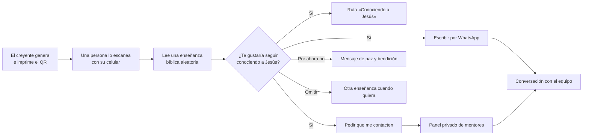

# Un Encuentro con Jesús
## Sustentación del proyecto de evangelismo

> **«Un código, una enseñanza, una oportunidad para conocer a Jesús»**

| | |
|---|---|
| **Autor** | Jesús Antonio |
| **Tipo de proyecto** | Evangelismo personal apoyado en tecnología (códigos QR + sitio web) |
| **Sitio en vivo** | https://jquinterocard.github.io/evangelismo/ |
| **Código fuente** | https://github.com/jquinterocard/evangelismo |

---

## 1. Resumen

*Un Encuentro con Jesús* es una herramienta para compartir el evangelio por medio de **códigos QR impresos** en tarjetas, volantes o carteles. Quien escanea el código con su celular recibe, **sin instalar nada y sin dar datos**, una enseñanza bíblica breve centrada en Jesucristo. Cada enseñanza incluye versículo, explicación, reflexión, aplicación práctica y oración.

Al terminar de leer, la persona puede decir libremente si quiere seguir conociendo a Jesús. Si responde que sí, puede **escribirnos por WhatsApp** o **pedir que un mentor la contacte**, y desde ahí comienza un acompañamiento personal.

El proyecto une tres momentos del evangelismo:

**sembrar** (la tarjeta con el QR) → **anunciar** (la enseñanza bíblica) → **acompañar** (el seguimiento por un mentor).

---

## 2. Fundamento bíblico

El proyecto no nace de la tecnología, sino del mandato de Jesús. La tecnología es solo el medio.

| Pasaje | Principio | Cómo se aplica en el proyecto |
|---|---|---|
| **Mateo 28:19-20** — «Por tanto, vayan y hagan discípulos de todas las naciones…» | Se nos manda **hacer discípulos**, no solo repartir información. | El objetivo no termina en la lectura: quien dice «Sí» puede ser acompañado por un mentor. |
| **Romanos 10:14** — «¿Y cómo creerán en aquel de quien no han oído?» | Alguien tiene que llevar el mensaje. | Cada tarjeta lleva el mensaje a lugares adonde no siempre llegamos en persona. |
| **Marcos 4:3-20** (parábola del sembrador) | Sembramos en todo tipo de terreno; el fruto lo da Dios. | Se reparten QR con generosidad y sin presionar. Los números no miden el valor espiritual de nadie. |
| **1 Pedro 3:15** — «…háganlo con gentileza y respeto» | El testimonio se da con respeto a la libertad del otro. | Las tres respuestas («Sí», «Por ahora no», «Omitir») tienen el mismo peso. No hay presión ni insistencia. |
| **1 Corintios 9:22** — «Me hice todo para todos, a fin de salvar a algunos por todos los medios posibles.» | Usar los medios de cada época. | Hoy casi todos tienen un celular en la mano: el QR lleva el evangelio a ese espacio. |
| **Hechos 2:42** | La fe crece en comunidad: enseñanza, comunión y oración. | El mentor conecta a la persona con una comunidad, no solo con un sitio web. |

> Las citas son de la Nueva Versión Internacional (NVI). Conviene verificarlas contra una Biblia impresa antes de la exposición.

---

## 3. El problema que atiende

1. **Muchos creyentes quieren compartir su fe, pero no saben cómo empezar.** Les falta tiempo, confianza o material adecuado.
2. **El volante tradicional se lee poco** y no permite saber si sirvió.
3. **Quien muestra interés suele perderse.** Aunque alguien quede tocado por un mensaje, no tiene una forma sencilla de pedir ayuda, y nosotros no tenemos cómo encontrarlo.
4. **Muchas herramientas digitales** cuestan dinero, exigen registrarse o recogen datos personales sin cuidado.

---

## 4. Objetivos

### Objetivo general
Facilitar la proclamación del evangelio de Jesucristo mediante enseñanzas bíblicas breves accesibles con un código QR, y **acompañar personalmente** a quienes deseen conocer más a Jesús.

### Objetivos específicos
1. Ofrecer **60 enseñanzas bíblicas originales** organizadas en **20 temas**: el amor de Dios, la salvación, el perdón, la fe, la esperanza, la oración, la gracia, el arrepentimiento, las parábolas y los milagros de Jesús, entre otros.
2. Permitir que cualquier creyente **genere e imprima sus propios códigos QR** de forma gratuita.
3. Dar a cada lector la oportunidad de **responder libremente** si quiere seguir conociendo a Jesús.
4. Conectar a los interesados con **un mentor**, por WhatsApp o por una solicitud de contacto.
5. **Medir con honestidad** el alcance (lecturas e interés) para orar y planificar mejor.
6. Proteger la **privacidad y la dignidad** de cada persona.

---

## 5. ¿Cómo funciona?

### 5.1 Sembrar: el creyente que comparte
- Entra a la sección **Generar QR** del sitio.
- Elige una plantilla (cruz, corazón, paloma, Biblia o minimalista) y los colores.
- Descarga el código, una **tarjeta lista para imprimir** o un **lote de hasta 100 códigos**.
- Reparte las tarjetas en la calle, el trabajo, la universidad, un hospital, una tienda o un evento.

### 5.2 Anunciar: la persona que escanea
Cada enseñanza tiene cinco partes:
1. **Versículo bíblico** (NVI).
2. **Explicación** sencilla.
3. **Reflexión** espiritual.
4. **Aplicación práctica** para el día.
5. **Oración sugerida**.

El mismo código muestra **una enseñanza distinta en cada visita**. Así, quien vuelva a escanearlo siempre encuentra algo nuevo.

### 5.3 La pregunta final
> **«¿Te gustaría seguir conociendo a Jesús?»**
> ❤️ *Sí, quiero aprender más* · *Por ahora no, gracias* · *Omitir*

Las tres opciones tienen el mismo tamaño y el mismo peso: invitamos, no presionamos. Quien dice «Por ahora no» recibe un mensaje de paz y bendición, y nada más.

### 5.4 Acompañar: el seguimiento
Si la persona responde **«Sí»**, aparece **«¿Quieres hablar con alguien?»** con dos caminos:

| Opción | Qué pasa |
|---|---|
| **Escribir por WhatsApp** | Se abre un chat con el número del equipo y un mensaje ya escrito, por ejemplo: *«Hola, leí la enseñanza "Un amor que lo dio todo" y me gustaría hablar con alguien sobre Jesús.»* |
| **Prefiero que me contacten** | La persona deja su nombre y su WhatsApp, y si quiere su correo, cómo prefiere que la contacten (mensaje, llamada o en persona) y una **petición de oración**. Siempre con su **autorización expresa**. |

Las solicitudes llegan a un **panel privado de mentores**. Allí cada mentor:
- ve a las personas que pidieron contacto y su petición de oración;
- les escribe por WhatsApp con un solo toque;
- registra el avance: **nuevo → contactado → en acompañamiento → cerrado**;
- deja notas para el equipo.

Así el proyecto no se queda en «repartir información». Pasa de la siembra al **discipulado**.

---

## 6. Principios éticos

El evangelismo debe reflejar el carácter de Cristo. Por eso el proyecto se construyó sobre estos principios:

1. **Libertad:** nadie está obligado a responder ni a dejar sus datos. Cada persona responde a Dios con libertad.
2. **Respeto:** no hay mensajes insistentes, ventanas emergentes ni presión emocional.
3. **Privacidad:**
   - para leer no se piden nombre, correo ni teléfono, y no se guardan direcciones IP;
   - los datos de contacto solo se guardan si la persona los da voluntariamente y con autorización, conforme a la **Ley 1581 de 2012** de protección de datos personales en Colombia;
   - solo los mentores autorizados pueden verlos, y la persona puede pedir que se borren en cualquier momento.
4. **Honestidad en los números:** una lectura no es una conversión y un «Sí» no es una decisión de fe. Es interés en seguir aprendiendo. Los indicadores sirven para **orar y planificar**, no para competir ni para medir el valor espiritual de nadie.
5. **Gratuidad:** el material es gratuito para quien lo lee y para quien lo comparte (Mateo 10:8: «Lo que ustedes recibieron gratis, denlo gratuitamente»).

---

## 7. ¿Cómo sabemos si funciona? (indicadores)

La sección **Impacto** del sitio muestra en tiempo real:

| Indicador | Qué significa |
|---|---|
| **Enseñanzas completadas** | Veces que alguien leyó y respondió la pregunta final |
| **Respuestas positivas** | «Sí, quiero aprender más» |
| **Respuestas negativas** | «Por ahora no, gracias» |
| **Preguntas omitidas** | Eligió «Omitir» |
| **Tasa de interés positivo** | positivas ÷ (positivas + negativas) × 100 |
| **Solicitudes de contacto** | Personas que pidieron que un mentor las acompañe (panel de mentores) |

### Resultados hasta la fecha
> *Completar con los datos reales de la página **Impacto** el día de la exposición.*

| Indicador | Valor |
|---|---|
| Tarjetas QR repartidas | ____ |
| Enseñanzas completadas | ____ |
| Respuestas «Sí» | ____ |
| Solicitudes de contacto | ____ |
| Personas en acompañamiento | ____ |
| Testimonio destacado (con permiso) | ____ |

---

## 8. Recursos y costo

| Recurso | Costo |
|---|---|
| Sitio web (GitHub Pages) | Gratis |
| Base de datos (Supabase, plan gratuito) | Gratis |
| Generador de códigos QR | Gratis (incluido en el sitio) |
| Impresión de tarjetas | El único gasto: depende de la cantidad (por ejemplo, 100 tarjetas) |
| Mentores | Voluntarios de la iglesia |

**Costo tecnológico: $0.** El proyecto lo puede replicar cualquier iglesia o grupo sin presupuesto.

---

## 9. Tecnología (resumen para no técnicos)

- Es una **página web** que funciona en cualquier celular y también se puede instalar como app.
- Se usa con la **cámara del celular**: no hay que descargar nada.
- Las respuestas y las solicitudes se guardan en una **base de datos protegida**. Nadie puede leerlas o modificarlas desde fuera, solo los mentores autorizados después de iniciar sesión con su correo.
- Tiene protecciones contra el abuso, como límites de envíos y la regla de una sola respuesta por lectura.
- Antes de cada publicación, el sistema corre **más de 100 pruebas automáticas** para comprobar que todo funciona.

| Componente | Herramienta |
|---|---|
| Sitio web | Next.js, React y TypeScript |
| Base de datos e inicio de sesión de mentores | Supabase (PostgreSQL) |
| Publicación | GitHub Pages con despliegue automático |

---

## 10. Cómo implementarlo en una iglesia o grupo

1. **Formar el equipo:** de 2 a 5 mentores dispuestos a acompañar con oración y paciencia.
2. **Imprimir las tarjetas:** generar los QR en el sitio y mandarlos a imprimir.
3. **Orar antes de salir** por las personas que recibirán las tarjetas.
4. **Repartir con una sonrisa y una frase sencilla**, por ejemplo: *«Te regalo un mensaje de esperanza; escanéalo cuando tengas un momento.»*
5. **Responder rápido:** revisar el panel y WhatsApp a diario. Un mensaje a tiempo vale mucho.
6. **Acompañar:** conversación, oración y, cuando la persona lo desee, invitación a un grupo o a la iglesia.
7. **Evaluar cada mes:** revisar el Impacto, orar por los resultados y ajustar los lugares de siembra.

---

## 11. Limitaciones y desafíos

- **La herramienta no reemplaza la relación personal.** El Espíritu Santo obra a través de personas. El QR solo abre la puerta.
- **Depende de que haya mentores disponibles.** Si alguien pide contacto y nadie responde, el daño es mayor que no haberlo ofrecido.
- **Requiere un celular con internet.** Para quien no lo tiene, el evangelismo cara a cara sigue siendo insustituible.
- **Los números tienen límites.** No sabemos qué ocurre en el corazón de quien lee; sembramos y confiamos en Dios (1 Corintios 3:6-7).

---

## 12. Próximos pasos

- Avisos automáticos a los mentores cuando llega una nueva solicitud.
- Asignar cada solicitud a un mentor específico.
- Estadísticas por campaña, para saber qué lugares dan más fruto.
- Peticiones de oración anónimas.
- Sección de **preguntas difíciles** (¿existe Dios?, ¿por qué hay sufrimiento?).
- Testimonios breves de la comunidad.

---

## 13. Conclusión

*Un Encuentro con Jesús* no busca reemplazar el evangelismo personal, sino **multiplicarlo**. Una tarjeta en la mano de alguien puede abrir una conversación que nosotros no habríamos podido empezar. Cuando esa persona dice «Sí, quiero aprender más», hay un mentor dispuesto a escucharla, orar con ella y caminar a su lado.

Usamos las herramientas de nuestro tiempo para cumplir el mismo mandato de siempre: **ir y hacer discípulos** (Mateo 28:19), con gentileza y respeto (1 Pedro 3:15), sembrando con fe y confiando en que es Dios quien da el crecimiento (1 Corintios 3:7).

<em>«Que la paz de Cristo llene tu corazón hoy y siempre.»</em> 🕊️

---

## Anexo A. Guion sugerido para la exposición (8–10 minutos)

| Minuto | Parte | Qué decir o mostrar |
|---|---|---|
| 0:00 | **Apertura** | Leer Romanos 10:14 y preguntar: «¿Cuántas personas conocemos que nunca han oído el evangelio de forma clara?» |
| 1:00 | **El problema** | Sección 3: queremos compartir, pero no sabemos cómo, y perdemos a los interesados. |
| 2:00 | **La propuesta** | Mostrar una tarjeta impresa con el QR. |
| 2:30 | **Demostración en vivo** | Proyectar un QR y pedir que alguien del grupo lo escanee y lea la enseñanza. |
| 4:00 | **La pregunta final** | Responder «Sí» y mostrar el botón de WhatsApp y el formulario de contacto. |
| 5:00 | **El seguimiento** | Explicar el panel de mentores y los estados del acompañamiento. |
| 6:00 | **Ética** | Libertad, respeto, privacidad y honestidad en los números (sección 6). |
| 7:00 | **Resultados** | Mostrar la página Impacto y la tabla de la sección 7. |
| 8:00 | **Conclusión** | Sección 13 y Mateo 28:19-20. |
| 8:30 | **Preguntas** | Usar el Anexo B. |

**Antes de exponer:**
- Abrir el sitio y la página Impacto unos minutos antes, para que la base de datos «despierte».
- Llevar tarjetas impresas de respaldo por si falla el proyector.
- Si se hace la demostración del formulario, usar datos de prueba y borrarlos después desde el panel.

---

## Anexo B. Preguntas frecuentes

**¿No es muy impersonal evangelizar con un código QR?**
El QR no reemplaza a la persona, la acerca. Normalmente alguien entrega la tarjeta en mano, y quien quiere seguir conversando termina hablando con un mentor real.

**¿Se guardan datos de quien escanea?**
Para leer, no: solo se registra de forma anónima qué enseñanza se leyó y la respuesta voluntaria. Los datos de contacto solo se guardan si la persona los da, con autorización expresa, y puede pedir que se borren.

**¿Un «Sí» significa que la persona se convirtió?**
No. Significa que quiere seguir aprendiendo. La conversión es obra de Dios en el corazón; nosotros sembramos y acompañamos.

**¿Cuánto cuesta?**
La parte tecnológica es gratuita. Solo se gasta en imprimir las tarjetas.

**¿Las enseñanzas tienen sana doctrina?**
Son textos originales centrados en Jesucristo, basados en citas bíblicas verificables de la NVI, y pueden revisarse con los líderes de la iglesia.

**¿Qué pasa si nadie responde a quien pidió contacto?**
Ese es el mayor riesgo, por eso el proyecto exige un equipo de mentores comprometido y revisar el panel a diario.

**¿Otra iglesia puede usarlo?**
Sí. El código es abierto y el sitio se puede replicar sin costo.

---

## Anexo C. Demostración en vivo, flujo por flujo

Para la clase conviene tener **dos pantallas**:
- **Computadora con el proyector:** para el lado del creyente que comparte (generar QR, ver Impacto y el panel de mentores).
- **Celular:** para el lado de la persona que escanea. Si se puede, proyecta también el celular, por ejemplo con un cable o una app para duplicar la pantalla.

Antes de empezar, deja abiertas estas pestañas en la computadora:
1. `https://jquinterocard.github.io/evangelismo/qr/` (Generar QR)
2. `https://jquinterocard.github.io/evangelismo/impacto/` (Impacto)
3. `https://jquinterocard.github.io/evangelismo/seguimiento/` (panel de mentores, con la sesión ya iniciada)

### Flujo 1. Generar el QR · *en la computadora*
| Haz esto | Di esto |
|---|---|
| En el menú superior, abre **Generar QR**. | «Cualquier creyente puede crear sus propios códigos, gratis.» |
| Elige la plantilla **Cruz** y cambia un color. | «Podemos personalizarlo: cruz, corazón, paloma, Biblia…» |
| Pulsa **Generar nuevo QR**. | «Cada código es único, y cada vez que alguien lo escanea muestra una enseñanza distinta.» |
| Pulsa **Tarjeta PNG** y abre la imagen descargada. | «Esta es la tarjeta que llevamos a la imprenta.» |
| Baja a **Generar varios códigos**, pon 20 y señala **Descargar lote ZIP**. | «Para una campaña podemos sacar hasta 100 códigos de una vez.» |
| Deja el QR grande en pantalla. | «Ahora, ¿alguien me ayuda a escanearlo?» |

*En el celular* el flujo es el mismo: en la barra inferior toca **QR**. Así puedes generar una tarjeta en el momento, en la calle, y compartirla por WhatsApp con **Compartir**.

### Flujo 2. Escanear y leer · *en el celular de un voluntario*
| Haz esto | Di esto |
|---|---|
| Que un compañero abra la **cámara** del celular y apunte al QR proyectado. | «No hay que instalar nada: basta con la cámara.» |
| Se abre la enseñanza. | «Fíjense: no pide registro, ni datos, ni hay publicidad.» |
| Recorre la enseñanza de arriba abajo. | «Tiene cinco partes: versículo, explicación, reflexión, aplicación práctica y oración.» |
| Muestra el botón **Compartir por WhatsApp** de la enseñanza. | «Si le gustó, puede enviársela a alguien más con un toque. El mensaje se multiplica solo.» |
| Que otra persona escanee el mismo QR. | «Mismo código, enseñanza distinta: si la persona lo vuelve a escanear mañana, encuentra algo nuevo.» |

### Flujo 3. La pregunta final · *en el celular*
| Haz esto | Di esto |
|---|---|
| Baja hasta **«¿Te gustaría seguir conociendo a Jesús?»**. | «Al terminar, invitamos sin presionar: las tres opciones tienen el mismo tamaño.» |
| Explica que los botones se activan tras unos segundos de lectura. | «Así sabemos que la persona realmente leyó.» |
| (Opcional) En un segundo celular, toca **Por ahora no, gracias**. | «Si dice que no, solo recibe una bendición. No insistimos.» |
| Toca **Sí, quiero aprender más ❤️**. | «Y si dice que sí, se abren caminos para seguir…» |

### Flujo 4. «¿Quieres hablar con alguien?» · *en el celular*
| Haz esto | Di esto |
|---|---|
| Muestra el bloque **¿Quieres hablar con alguien?**. | «Aquí pasamos de la información a la relación.» |
| Toca **Escribir por WhatsApp** (no lo envíes). | «Se abre WhatsApp con el mensaje ya escrito, incluso con el nombre de la enseñanza. Solo tiene que pulsar enviar.» |
| Vuelve y toca **Prefiero que me contacten**. | «Si le da pena escribir primero, puede dejarnos sus datos.» |
| Llena el formulario con **datos de prueba**: nombre, otro número, «Llamada», una petición de oración. | «Pedimos lo mínimo, y la petición de oración es opcional.» |
| Señala la casilla de **autorización**. | «Sin su permiso expreso no guardamos nada. Así lo pide la Ley 1581 de protección de datos.» |
| Pulsa **Enviar solicitud**. | «Listo: un mentor la contactará con respeto y sin presión.» |

### Flujo 5. Panel de mentores · *en la computadora*
| Haz esto | Di esto |
|---|---|
| Cambia a la pestaña **/seguimiento/** y pulsa **Actualizar**. | «Este panel es privado: solo entran los mentores autorizados, con su correo.» |
| Muestra la tarjeta de la solicitud que se acaba de enviar. | «Aquí está la persona que acaba de pedir contacto, con su petición de oración.» |
| Señala **Abrir WhatsApp**. | «Con un toque, el mentor le escribe con un saludo ya listo.» |
| Cambia el estado a **Contactado**, escribe una nota y pulsa **Guardar**. | «Registramos el avance: nuevo, contactado, en acompañamiento. Nadie se queda olvidado.» |
| Pulsa **Eliminar** y confirma. | «Y si la persona lo pide, sus datos se borran.» (Así también limpias el dato de prueba.) |

*En el celular*, el mentor entra a la misma dirección `/seguimiento/` y ve las mismas tarjetas, una debajo de otra, para trabajar desde cualquier lugar.

### Flujo 6. Impacto · *en la computadora*
| Haz esto | Di esto |
|---|---|
| Cambia a la pestaña **Impacto** y pulsa **Actualizar**. | «La lectura que hicimos hace un momento ya aparece aquí.» |
| Muestra las tarjetas y las gráficas. | «Vemos enseñanzas completadas, respuestas y la tasa de interés por día, semana y mes.» |
| Muestra las enseñanzas más leídas. | «Esto nos ayuda a orar y planificar mejor.» |
| Cierra con el principio ético. | «Un número no es una conversión. Sembramos con fe y es Dios quien da el crecimiento.» |

### Si algo falla durante la demostración
| Problema | Solución |
|---|---|
| No hay internet en el salón | Usa los datos del celular, o muestra capturas de pantalla preparadas. |
| El proyector no muestra bien el QR | Reparte una tarjeta impresa para escanear. |
| «No pudimos conectar con el servidor» | La base de datos estaba dormida: espera unos segundos y vuelve a intentarlo. Por eso conviene abrir Impacto antes. |
| El formulario dice «muchas solicitudes» | Es la protección contra abuso, que limita los envíos repetidos. Usa otro número de prueba o muestra el formulario sin enviarlo. |

---

## Anexo D. En la calle: cómo usarlo al evangelizar a alguien

La herramienta funciona mejor como **complemento de una conversación**, no como reemplazo.

### Antes de salir
1. **Orar** por las personas con las que vas a hablar.
2. Llevar **tarjetas impresas** en el bolsillo y el celular con batería y datos.
3. Tener abierto en el celular el sitio `jquinterocard.github.io/evangelismo`. Si quieres, instálalo como app desde el menú del navegador con **«Agregar a la pantalla de inicio»**.

### Situación 1. Encuentro breve: no hay tiempo para conversar
> *«Hola, ¿cómo estás? Te quiero regalar un mensaje de esperanza. Cuando tengas un momento, escanéalo con la cámara de tu celular. ¡Que Dios te bendiga!»*

- Entregas la tarjeta y sigues tu camino. No hace falta más.
- Si quiere, la persona leerá después y podrá escribir por WhatsApp o pedir contacto.

### Situación 2. Hay una conversación (en el bus, en una fila, en el trabajo)
1. **Escucha primero.** Interésate por la persona: cómo está, qué le preocupa.
2. Si surge el tema de Dios, la fe o un problema personal:
   > *«¿Te puedo mostrar algo corto que me ha ayudado mucho?»*
3. Saca el celular, abre **Enseñanzas** y busca un tema que tenga que ver con lo que te contó: **perdón**, **esperanza**, **paz** o **confianza en Dios**. También puedes regalarle la tarjeta para que lo escanee ella misma.
4. Lean juntos el versículo y la reflexión. **Comparte en una frase tu propio testimonio.**
5. Pregunta con naturalidad:
   > *«¿Te gustaría seguir conociendo a Jesús?»*
   - **Si dice que sí:** ofrécele orar ahí mismo, y deja que ella toque **«Sí, quiero aprender más»** y luego **«Escribir por WhatsApp»** o **«Prefiero que me contacten»**. Así queda conectada con un mentor.
   - **Si dice que no:** respétalo, bendícela y regálale la tarjeta: *«Por si algún día quieres leer algo más.»*

### Situación 3. Alguien atraviesa un momento difícil
- No empieces con la herramienta: **escucha, consuela y ofrece orar**.
- Después, si es oportuno, muéstrale una enseñanza sobre **esperanza**, **paz** o **la confianza en Dios**.
- Invítale a dejar su **petición de oración** en **«Prefiero que me contacten»**, para que el equipo siga orando y acompañándole.

### Situación 4. Compartir a distancia
- En el celular, abre una enseñanza y toca **Compartir por WhatsApp**, o usa el botón verde flotante para enviar el sitio.
- Funciona muy bien con familiares, amigos o compañeros que no ves a menudo.

### Después del encuentro
- Si la persona pidió contacto, **revisa el panel ese mismo día** y escríbele pronto.
- Marca el estado en el panel (**contactado**, **en acompañamiento**) y anota lo importante: por qué orar, la próxima cita.
- Ora por cada persona, aunque nunca sepas qué pasó con ella (Isaías 55:11).

### Lo que conviene evitar
- ❌ Insistir si la persona dice que no.
- ❌ Pedirle sus datos tú mismo o llenarle el formulario sin su permiso. Debe hacerlo ella, y por voluntad propia.
- ❌ Presentar la tarjeta como una encuesta o una promoción. Es un regalo.
- ✅ Sonreír, escuchar, orar y dejar que Dios haga su obra.

